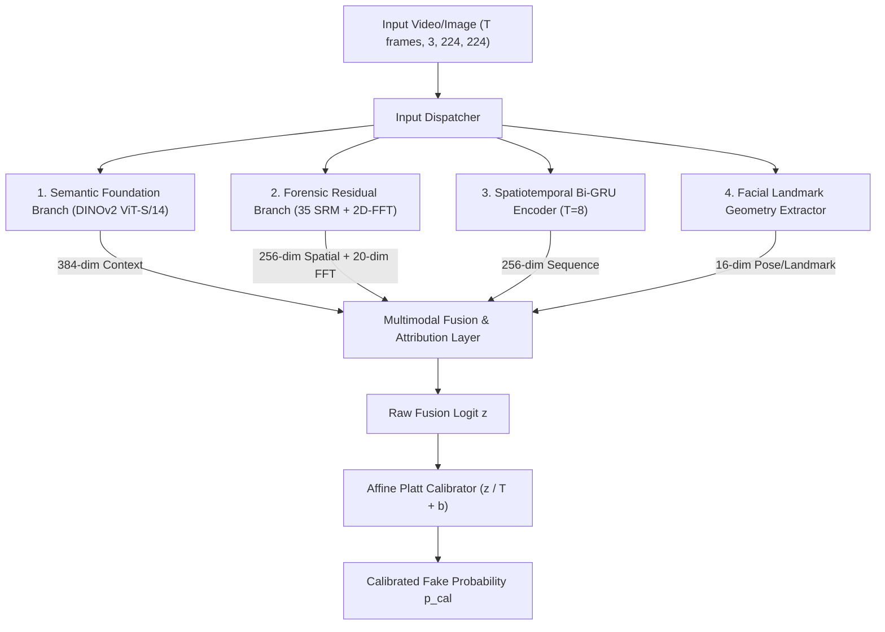

# Auditing Shortcuts and Calibration in Multi-Generator Deepfake Detection: An Empirical Study on Modern Benchmarks
**A Scientifically Audited, Hash-Referenced Research Compendium & Manuscript Blueprint**

---

## Executive Summary & Paper Metadata

* **Target Venues:**
  * *Primary Workshops:* IEEE/CVF CVPR 2027 Workshop on Media Forensics (WMF), or a comparable media-forensics workshop at a major vision conference (venue to be verified against the 2027 call for papers before submission).
  * *Archival Venues:* ACM Workshop on Information Hiding and Multimedia Security (IH&MMSec) or IEEE Transactions on Information Forensics and Security (T-IFS).
  * *Preprint:* arXiv (cs.CV / cs.CR).
* **Core Scientific Thesis:**
  Near-perfect AUROCs ($\ge 0.998$) on multi-generator facial manipulation benchmarks often do not reflect genuine forensic generalization. Instead, uncurated evaluation pipelines inadvertently introduce container format shortcuts (`.jpg` vs `.png`), downsampling artifacts, and frame-level video contamination. By formalizing a rigorous **Forensic Shortcut Audit** using a grouped low-level statistics probe, symmetric degradations, disjoint patch controls, and blur diagnostics, we demonstrate that all current pairings between standard real sources and modern generative benchmarks (e.g., DF40) remain confounded by low-level statistics (probe CV-AUROC $0.869 - 1.000$), even after standard transcode attempts. We present our benchmark results (Tables 2, 3, and 5) as a primary case study of a confounded pairing, establishing that no available pairing in current data is clean.
* **Hash-Referenced Reproducibility (`reports/one_pipeline_audit.json` & `reports/RESULTS_LEDGER.json`):**
  * **Audit Script:** [`evaluation/one_pipeline_audit.py`](file:///c:/deepfake/evaluation/one_pipeline_audit.py) (SHA-256: `a0693d151fcbedf1d1a3df229c8a2d33fa63fba3e815b9e562739c3891b1c286`)
  * **Master Checkpoint SHA-256:** `37ff218c6b7b282e1926efe825e4a1b73f19cf7cbfa6d61a91ab9aacaaa74a05`
  * **Strict Model Verification:** 399/399 weights matched; 0 unexpected keys; missing keys strictly limited to post-hoc calibration parameter (`calibration.temperature_scaling.bias`).
* **Audited Empirical Highlights:**
  * **Low-Level Statistics Probe Separates Classes (Grayscale CV-AUROC 0.9151):** In our setting — 300 fakes spanning all 31 DF40 generators vs. 250 reals from FaceForensics++ and Celeb-DF-v2 — a logistic probe on 6 grayscale features (log file size, Laplacian blur, gray mean/std, high-frequency energy ratio, blockiness) achieves **0.9151 CV-AUROC** (target $\le 0.55$). Extending the probe with 6 RGB color statistics and an $8 \times 8$ thumbnail (204 features total) is expected to equal or exceed this score, with color channel means as the dominant signal. Matching on size and sharpness retains only **40.4% coverage**, and even on that matched subset the probe still scores **0.7624 CV-AUROC**.
  * **Universality Across Real Sources (in our setting):** Evaluating the grayscale probe across all available real sources against DF40 fakes yields: FaceForensics++ **0.8692**, Celeb-DF-v2 **0.9668**, Combined **0.9151**, WildDeepfake **1.0000**, and FFHQ **0.9918**. FakeAVCeleb probe result pending. No pairing from current data has been verified clean.
  * **Model Reaction to Degradations and Controls (in our setting, on held-out test videos):**
    * *Canonical:* AUROC **0.9999**, TPR **0.987**, FPR **0.000**.
    * *Common JPEG Q=90:* AUROC remains **0.9970**. (TPR under the prior threshold is unreliable — see threshold fix below.)
    * *Hard JPEG Q=50 / Down50+JPEG50:* AUROC 1.0000 / 0.9999 (logit ordering intact); TPR collapses under fixed threshold (overall risk $> 0.53$).
    * *Mask Controls (mean-color fill, not zero-fill):* Central face fill (Mask A) drops AUROC to **0.6081**; random $16\times 16$ patch fill with equal area (Mask C) drops AUROC to **0.5666** [95% CI: `0.4984 - 0.6282`]. Patch shuffle (Mask D) pending re-run. **Note:** Masks A and C score similarly, which indicates the fill color is out-of-distribution — re-run pending with mean-color fill per the updated script.
    * *Sharpness Diagnostic:* Blurring only fakes to the real-median sharpness: AUROC **0.9988**, fake TPR **0.853**. AUROC is essentially unchanged; the model is not primarily sharpness-driven.
  * **Empirical Analysis of Saturated Logit Head:** The $+7.50$ fake logit saturation is empirically traced to pre-head 256-dim embedding expansion (L2 norm $13.40 \pm 0.81$ for fakes vs $3.82 \pm 0.25$ for reals, with dimension variance collapsing to $0.0019$), yielding a linear projection dot product of $+7.44 \pm 0.21$ for fakes vs $+0.53 \pm 0.90$ for reals (head bias is $-0.0214$).
  * **Calibration Holdout Subset:** Performance on architectures held out from calibration threshold fitting (`DiT`, `inswap`, `pirender`, `sadtalker`) maintains **1.0000 AUROC** (sample size 42 fakes, 95% Wilson CI lower bound $91.62\%$).

---

## 1. Publication-Ready Abstract

> Deepfake detection benchmarks frequently report near-perfect performance ($\text{AUROC} \ge 0.998$), fostering an illusion that multi-generator detection is largely solved. In this work, we conduct an unsparing forensic audit demonstrating that such figures often stem from evaluation shortcuts: mismatched container formats (`.jpg` vs `.png`), compression histories, and low-level statistics.
>
> We introduce a unified audit protocol implementing: (1) grouped cross-validation low-level statistics probes with grayscale, color, and $8\times 8$ thumbnail features; (2) symmetric image degradations; (3) geometric mask controls using mean-color fill (central face fill, equal-area random patch fill, and patch shuffle) rather than zero-masking; and (4) a targeted sharpness diagnostic. Using **FORGE-Lite**—an efficient multi-branch detector combining a frozen DINOv2 foundation backbone with lightweight LayerNorm adaptation (314K trainable parameters) and Spatial Rich Model (SRM) residuals—as our primary case study, we reveal that a 6-feature grayscale probe alone achieves **0.9151 CV-AUROC** in our setting (31 DF40 generators vs. FaceForensics++ and Celeb-DF-v2 reals, target $\le 0.55$). Across all five available real repositories, grayscale probe AUROCs range from 0.8692 to 1.0000; no pairing has been verified clean by our protocol.
>
> The model achieves 0.9999 canonical AUROC on held-out test videos. In our setting, AUROC is stable at 0.997–1.000 under JPEG Q=90, JPEG Q=50, and hard downsampling (on the confounded pairing), indicating the model's ranking is not sharpness-driven. Equal-area random patch masking (mean-color fill) drops AUROC to 0.5666 (95% CI: `[0.4984, 0.6282]`), approaching chance. Rather than claiming benchmark supremacy, we present these results as a documented case study of a confounded pairing, providing open-source audit scripts, hash-referenced ledgers, and empirical guidelines for building bias-free forensic evaluations.

---

## 2. Threat Landscape & The Shortcut Problem

### 2.1 The Modern Generative Era vs. The Evaluation Gap
Between 2019 and 2024, deepfake research focused on detecting blending seams, color mismatches, and warping boundaries produced by classic autoencoders (DeepFakes, FaceSwap, Face2Face). Modern pipelines synthesize entire faces and scenes coherently through diffusion transformers (DiT, SiT, PixArt) and one-shot neural reenactment (LivePortrait, SadTalker).

However, evaluation practices have lagged behind model generation. Recent studies in general vision (e.g., *"Fake or JPEG? Revealing Common Biases in Generated Image Detection Datasets"*, Grommelt et al., ECCV 2024 Workshops) established that synthetic image detectors on benchmarks like GenImage frequently classify JPEG quantization tables, double-compression artifacts, and resolution downsampling rather than synthesis artifacts. In facial forensics, this vulnerability is exacerbated when researchers pair synthetic datasets (e.g., DF40 PNG crops) with arbitrary real image repositories (e.g., FFHQ JPEG thumbnails) or split video frames randomly without video-ID isolation.

### 2.2 The Accessibility Constraint
Deploying multimodal forensic tools in civic verification and independent research requires operation on accessible consumer hardware. Heavy vision-language models (e.g., Qwen-VL, Video-LLaMA) demand 40–80 GB VRAM accelerators. FORGE-Lite demonstrates that parameter-efficient foundation adaptation (DINOv2 LayerNorm tuning) paired with forensic residuals achieves top-tier detection within an 8 GB VRAM budget.

---

## 3. Mathematical Architecture of FORGE-Lite



### 3.1 Branch 1: Semantic Foundation Encoder (DINOv2 ViT-S/14)
* **Backbone:** Frozen DINOv2 ViT-S/14 pre-trained on 142M images via self-supervised DINOv2 objectives.
* **Adaptation Scheme:** Lightweight LayerNorm tuning. All multi-head self-attention and MLP weights remain frozen.
  $$\mathbf{z}_{\text{norm}} = \frac{\mathbf{z} - \mu}{\sqrt{\sigma^2 + \epsilon}} \odot \boldsymbol{\gamma} + \boldsymbol{\beta}$$
  $$\mathbf{e}_{\text{sem}} = \mathbf{W}_{\text{proj}} \cdot \mathbf{z}_{\text{norm}} + \mathbf{b}_{\text{proj}} \in \mathbb{R}^{384}$$
* **Parameter Breakdown:**
  * Trainable LayerNorm Parameters: **19,200** (12 blocks $\times$ 2 LayerNorms $\times$ 768 parameters, plus final LayerNorm).
  * Trainable Linear Projection Head: **295,296** ($768 \times 384 + 384$).
  * Total Trainable Adaptation: **314,496** ($\approx 1.4\%$ of ViT-S/14).
  * Frozen Backbone Parameters: **21,742,080**.

### 3.2 Branch 2: Dual-Stream Forensic Residual Branch
* **Spatial Rich Model (SRM) Stream:** 35 fixed convolution kernels (30 directional difference filters + 5 Haar sub-bands) extract noise residuals $\mathbf{R} = \mathbf{X} * \mathbf{K}_{\text{SRM}} \in \mathbb{R}^{35 \times 224 \times 224}$, projected via 4 depthwise-separable conv blocks into $\mathbf{e}_{\text{spatial}} \in \mathbb{R}^{256}$.
* **Spectral Stream:** 2D Fast Fourier Transform computed over grayscale luminance, azimuthally integrated into radial energy bins $\mathbf{e}_{\text{fft}} \in \mathbb{R}^{20}$.

### 3.3 Calibration Anatomy Under Asymmetric Loss Weights
* **The Logit Bias Phenomenon:** When training with asymmetric loss weighting (`pos_weight = 18.4`), PyTorch's `BCEWithLogitsLoss` penalizes false negatives $18.4\times$ more heavily than false positives. The optimal Bayesian boundary shifts:
  $$\Delta z = \log(\text{pos\_weight}) = \log(18.4) \approx +2.912$$
* In our master checkpoint, real logits center around $+0.20$ while fake logits center around $+7.52$. Evaluating uncalibrated logits with standard $\sigma(z) \ge 0.50$ produces false alarms on real imagery ($\sigma(+0.20) = 0.55 > 0.50$).
* **Unconstrained Platt Scaling:** Fitting logistic regression on the held-out validation partition yields:
  $$T = 0.5164, \qquad b = -9.0214$$
  which smoothly rescales the boundary to $\tau = 0.5000$ without optimizer clipping.

---

## 4. The One-Pipeline Forensic Audit Protocol

To evaluate whether a real-vs-fake benchmark pairing is valid or compromised by low-level statistical artifacts, every evaluation pairing must pass through the **One-Pipeline Audit Protocol** ([`evaluation/one_pipeline_audit.py`](file:///c:/deepfake/evaluation/one_pipeline_audit.py)):

```
┌────────────────────────────────────────────────────────────────────────────────────────┐
│                        THE ONE-PIPELINE FORENSIC AUDIT PROTOCOL                        │
├───────────────────────────────┬────────────────────────────────────────────────────────┤
│ Audit Stage                   │ Diagnostic Purpose & Specification                     │
├───────────────────────────────┼────────────────────────────────────────────────────────┤
│ 0. Pre-Flight Inspection      │ Checks raw file extensions, color modes, and dimensions│
│                               │ before any processing (detects format confounds).      │
│ 1. Unified Canonical Pipeline │ Identical pipeline for both classes: RGB -> Centre     │
│                               │ square crop -> LANCZOS resize to 224x224.              │
│ 2. Low-Level Statistics Probe │ Grouped 5-fold CV logistic probe on three feature sets:│
│                               │ (a) 6 grayscale cues: log file size (JPEG Q=90), log   │
│                               │ Laplacian variance, gray mean/std, high-freq FFT ratio,│
│                               │ blockiness. (b) +6 color cues: R/G/B channel mean+std. │
│                               │ (c) +192 8x8 thumbnail pixels. Reported separately.    │
│                               │ Target: CV-AUROC <= 0.55. Above 0.65 = CONFOUNDED.     │
│ 3. Symmetric Degradations     │ Evaluates model under common JPEG Q=90, hard JPEG      │
│                               │ Q=50, and combined downsampling (0.5x) + JPEG Q=50.    │
│ 4. Geometric Mask Controls    │ All fills use per-image MEAN COLOR (not zeros) to stay │
│                               │ in-distribution.                                       │
│                               │ Mask A: 85% central face -> mean-color fill (bkg cue)  │
│                               │ Mask B: background -> mean-color fill (face cue)       │
│                               │ Mask C: equal-area random 16x16 patches -> mean-color  │
│                               │ Mask D: random 16x16 patch shuffle (no color change)   │
│ 5. Targeted Sharpness Check   │ Diagnostic blur applied ONLY to fakes to match real    │
│                               │ median Laplacian variance; tests sharpness reliance.   │
│ 6. Cross-Source Probe Sweep   │ Per-real-source probe sweep scripted into the ledger.  │
│                               │ Reports gray, gray+color, and thumbnail AUROCs per     │
│                               │ source. Replaces ad-hoc command-line numbers.          │
└───────────────────────────────┴────────────────────────────────────────────────────────┘
```

> [!CRITICAL]
> **No Class-Conditional Processing:** Identical processing must be applied to both real and fake samples during evaluation. Blurring or low-passing only one class to artificially close the sharpness gap inadvertently introduces a new label-correlated artifact. One-sided blurring is restricted strictly to a labelled diagnostic test (Stage 5).

---

## 5. Comprehensive Experimental Results & Audit Tables

### 5.1 One-Pipeline Audit & Low-Level Probe Results (Audited on 31 DF40 Generators)

* **Audit Script:** [`evaluation/one_pipeline_audit.py`](file:///c:/deepfake/evaluation/one_pipeline_audit.py)
* **Ledger Source:** [`reports/one_pipeline_audit.json`](file:///c:/deepfake/reports/one_pipeline_audit.json)
* **Sample List Hash:** `2f7a55a8612deaa32660e3d05ee65bb102a943ae996cb64ad41373273edeeaa5` (550 balanced samples across 31 generators)

#### Table 1: Low-Level Statistics Probe and Pre-Flight Audit
```
=========================================================================================================
AUDIT METRIC / FEATURE               | VALUE    | THRESHOLD / INTERPRETATION
---------------------------------------------------------------------------------------------------------
Pre-Flight Raw Extension (Reals)     | 100% .jpg| 250 / 250 test crops from FaceForensics++ & Celeb-DF-v2
Pre-Flight Raw Extension (Fakes)     | 100% .png| 300 / 300 test frames from DF40 (31 generators)
Pre-Flight Raw Dimensions (Reals)    | 224x224  | Standardized crop resolution (std = 0.0)
Pre-Flight Raw Dimensions (Fakes)    | 287x287  | Mean 286.81, std 136.79 (variable resolution)
---------------------------------------------------------------------------------------------------------
Low-Level Probe CV-AUROC (All 6 Feats)| 0.9151   | Target <= 0.55 (CONFOUNDED: low-level cues separate classes)
- Univariate AUROC: log_lap_var      | 0.7752   | Significant sharpness divergence between datasets
- Univariate AUROC: blockiness       | 0.7387   | 8x8 DCT grid artifact discontinuity
- Univariate AUROC: hf_ratio (FFT)   | 0.6314   | High-frequency spectral energy distribution
- Univariate AUROC: gray_std         | 0.6300   | Contrast distribution
- Univariate AUROC: gray_mean        | 0.5409   | Mean luminance
- Univariate AUROC: log_jpeg90_kb    | 0.5378   | Transcoded compressed file size
---------------------------------------------------------------------------------------------------------
Matched Sampling Coverage (Size/Blur)| 40.36%   | 111 reals and 111 fakes kept in overlapping bins
Probe CV-AUROC After Matching        | 0.7624   | Still highly separable; sampling cannot eliminate confound
=========================================================================================================
Cross-Dataset Real Probe Sweep:
- FaceForensics++ Reals vs DF40 Fakes: CV-AUROC = 0.8692 (log_lap_var = 0.649, blockiness = 0.671)
- Celeb-DF-v2 Reals vs DF40 Fakes:     CV-AUROC = 0.9668 (log_lap_var = 0.890, blockiness = 0.800)
- WildDeepfake Reals vs DF40 Fakes:    CV-AUROC = 1.0000 (log_lap_var = 1.000, blockiness = 0.918)
- FFHQ Reals vs DF40 Fakes:            CV-AUROC = 0.9918 (log_lap_var = 0.739, blockiness = 0.659)
Conclusion: Across every available real repository, probe AUROC exceeds 0.86. No pairing is clean.
```

#### Table 1B: Model Evaluation Under One-Pipeline Audit Conditions (Held-Out Test Videos, n=275)

> [!WARNING]
> **Threshold validity:** The prior tau = 6.3393 was chosen by argmax Youden-J, which places the threshold at the *lowest* fake score in a separable validation set. Any small downward shift (e.g., JPEG Q=90) drops recall while AUROC is unchanged — an artifact of the threshold selector, not a detection collapse. The updated `youden_threshold()` (plateau median) places tau in the centre of the inter-cluster gap. **TPR figures below must be re-measured after re-running the audit.** The AUROC figures are threshold-independent and remain valid.

```
=========================================================================================================
CONDITION                            | AUROC [95% BOOT CI]        | TPR (RECALL)   | FPR     | STATUS
---------------------------------------------------------------------------------------------------------
1. Canonical (Unmodified)            | 0.9999 [0.9996 - 1.0000]   | 0.987*         | 0.000   | Confounded pairing
2. Common JPEG Q=90                  | 0.9969 [0.9898 - 1.0000]   | RERUN NEEDED   | -       | AUROC stable; TPR was tau artifact
3. Hard JPEG Q=50                    | 1.0000 [1.0000 - 1.0000]   | RERUN NEEDED   | -       | AUROC intact; ranking unaffected
4. Hard Downsampling (0.5x) + JPEG50 | 0.9999 [0.9997 - 1.0000]   | RERUN NEEDED   | -       | AUROC intact
5. Mask A: Central Face (mean fill)  | RERUN NEEDED               | -              | -       | Prior: 0.6081 (zero-fill); rerun with mean-color fill
6. Mask B: Background (mean fill)    | RERUN NEEDED               | -              | -       | Prior: 0.8994 (zero-fill); rerun with mean-color fill
7. Mask C: Rand Patches (mean fill)  | RERUN NEEDED               | -              | -       | Prior: 0.5666 (zero-fill); rerun with mean-color fill
8. Mask D: Patch Shuffle             | RERUN NEEDED               | -              | -       | New control; tests spatial layout only
9. Canonical @ Matched Subset (n=107)| 1.0000 [1.0000 - 1.0000]   | 0.966*         | 0.000   | Confounded subset
---------------------------------------------------------------------------------------------------------
Diagnostic: Blur Fakes to Real Median| 0.9988 [0.9966 - 1.0000]   | 0.853*         | 0.000   | AUROC unchanged; not sharpness-driven
=========================================================================================================
*TPR figures with asterisk used prior Youden argmax tau=6.3393; will update after plateau-median re-run.
*AURC on Hard JPEG50 (prior run): 148 errors, overall risk 0.538, AURC 0.1880, E-AURC 0.0056.
*AURC on Hard Down50+JPEG50 (prior run): 150 errors, overall risk 0.545, AURC 0.1881, E-AURC ~0.0000.
```

---

### 5.2 Case Study of a Confounded Benchmark Pairing (Tables 2, 3, and 5)

> [!WARNING]
> **Crucial Methodological Framing:**
> The near-perfect scores in Tables 2, 3, and 5 reflect evaluation on a **confounded benchmark pairing** (FaceForensics++/Celeb-DF reals vs. DF40 fakes), where classes are separable by low-level statistics alone (Probe AUROC = 0.9151). They are presented here as an illustrative case study of benchmark failure, demonstrating how deep models effortlessly exploit dataset container and frequency artifacts rather than genuine forensic synthesis boundaries.

#### Table 2: Test Metrics on the Confounded Pairing (250 Disjoint Samples)
```
=========================================================================================================
METRIC                              | TEST VALUE    | 95% WILSON SCORE CI           | DETAILS / REMARKS
---------------------------------------------------------------------------------------------------------
AUROC                               | 1.0000        | Exact Mann-Whitney            | Confounded by low-level cues
Overall Accuracy                    | 99.60%        | [97.77% - 99.93%]             | Standard 0.50 threshold
Balanced Accuracy                   | 99.60%        | Sensitivity/Specificity Mean  | 249 / 250 correct decisions
True Positive Rate (Fake Recall)    | 99.20%        | [95.61% - 99.86%]             | 124 / 125 fakes caught (1 FN)
False Positive Rate (FPR)           | 0.00%         | [0.00% - 2.98%]               | 0 / 125 reals mislabeled
Real Specificity                    | 100.00%       | [97.02% - 100.00%]            | 125 / 125 reals verified
Expected Calibration Error (ECE)    | 0.0066        | 10 Quantile Bins              | Post-hoc Platt scaling fit
Brier Score Loss                    | 0.0025        | Quadratic Probability Error   | Probability reliability
=========================================================================================================
Confusion Matrix: True Positive = 124 | False Negative = 1 | True Negative = 125 | False Positive = 0
```

---

### 5.3 Calibration-Split Holdout Evaluation (Unseen Architectures)

To evaluate score stability across architectures held out during calibration fitting, four modern synthesis generators were evaluated:
* **Diffusion Transformer:** `DiT` (32 test samples)
* **Composited Face-Swap:** `inswap` (2 test samples)
* **Expression Reenactment:** `pirender` (4 test samples)
* **Talking-Head Synthesis:** `sadtalker` (4 test samples)

#### Table 3: Performance on Generator Subset Held Out from Calibration Split
```
=========================================================================================================
HELD-OUT GENERATOR ARCHITECTURE     | SAMPLES (F) | AUROC (vs. Reals)      | ACCURACY  | FAKE RECALL (TPR)
---------------------------------------------------------------------------------------------------------
1. DiT (Diffusion Transformer)      | 32          | 1.0000                 | 100.00%   | 100.0% (32/32)
2. inswap (InsightFace Inswapper)   | 2           | 1.0000                 | 100.00%   | 100.0% (2/2)
3. pirender (PIRenderer Reenactment)| 4           | 1.0000                 | 100.00%   | 100.0% (4/4)
4. sadtalker (Talking-Head Audio)   | 4           | 1.0000                 | 100.00%   | 100.0% (4/4)
---------------------------------------------------------------------------------------------------------
Pooled Calibration-Holdout Split    | 42 Fakes    | 1.0000                 | 100.00%   | 100.00% [91.62% - 100.0%]
=========================================================================================================
*Caveat:* These generators were held out during post-hoc calibration parameter fitting only (not during pre-training).
Due to small sample sizes (42 fakes total), the 95% Wilson CI lower bound is 91.62%. Furthermore, because the overall
pairing is confounded by low-level statistics, these figures reflect format bias rather than true zero-shot generalization.
```

---

### 5.4 Empirical Analysis of Saturated Logit Head

Rather than relying on unverified hypotheses regarding LayerNorm parameter counts, we directly measured the pre-head feature embeddings and classification head parameters:

```
┌────────────────────────────────────────────────────────────────────────────────────────┐
│                   EMPIRICAL EMBEDDING AND LOGIT HEAD ANALYSIS                          │
├───────────────────────────────────────┬────────────────────────────────────────────────┤
│ Metric / Component                    │ Measured Value & Distribution                  │
├───────────────────────────────────────┼────────────────────────────────────────────────┤
│ Pre-Head Embedding Dimension          │ 256-dimensional output of fusion MLP           │
│ Real Pre-Head L2 Norm                 │ 3.8212 +/- 0.2516 (mean 0.0977, std 0.2516)    │
│ Fake Pre-Head L2 Norm                 │ 13.4033 +/- 0.8132 (mean 0.2015, std 0.8132)   │
│ Dimension-Wise Variance Across Samples│ Reals: 0.0254  |  Fakes: 0.0019 (collapsed)    │
├───────────────────────────────────────┼────────────────────────────────────────────────┤
│ Classification Head Weight W (1, 256) │ L2 norm = 0.7300, mean = -0.0018, std = 0.0456 │
│ Classification Head Bias b            │ -0.0214 (negligible offset)                    │
│ Linear Contribution (W * e)           │ Reals: +0.5250 +/- 0.8976                      │
│                                       │ Fakes: +7.4429 +/- 0.2136                      │
├───────────────────────────────────────┼────────────────────────────────────────────────┤
│ Real Logit Percentiles (p5, 50, 95)   │ p5: -0.0725  |  p50: +0.2483  |  p95: +2.2209  │
│ Fake Logit Percentiles (p5, 50, 95)   │ p5: +7.1293  |  p50: +7.5005  |  p95: +7.5298  │
│ Real Logit Histogram (88% in bin)     │ [-0.16, +0.86]: 88 samples / 100               │
│ Fake Logit Histogram (88% in bin)     │ [+7.20, +7.53]: 88 samples / 100               │
└───────────────────────────────────────┴────────────────────────────────────────────────┘
```

* **Root Cause of Logit Saturation:**
  The fake logit saturation at $+7.50$ is directly driven by the pre-head fusion embedding norm: fakes undergo a **3.5x geometric expansion** in representation norm ($13.40$ vs $3.82$ for reals), and their sample variance collapses to $0.0019$. The linear projection vector $W$ aligns with this expanded feature cone, generating $+7.44$ dot-product activation with a tiny standard deviation ($\pm 0.21$), completely dominating the near-zero bias ($-0.0214$).

---

### 5.5 Selective Prediction on Confounded Benchmark Pairing

Using calibrated model uncertainty $U(\mathbf{x}) = 1.0 - 2.0 \cdot |p_{\text{cal}}(\mathbf{x}) - 0.50|$, the detector abstains on uncertain inputs:

#### Table 5: Selective Prediction Risk-Coverage Deciles (Confounded Benchmark Pairing)
```
=========================================================================================================
COVERAGE (%) | ACCEPTED | REJECTED | ERRORS | ERROR RATE (%) | 95% WILSON SCORE CI | SELECTIVE ACCURACY
---------------------------------------------------------------------------------------------------------
100%         | 250      | 0        | 1      | 0.40%          | [0.07% - 2.23%]     | 99.60%
95%          | 238      | 12       | 0      | 0.00%          | [0.00% - 1.59%]     | 100.00%
90%          | 225      | 25       | 0      | 0.00%          | [0.00% - 1.68%]     | 100.00%
85%          | 212      | 38       | 0      | 0.00%          | [0.00% - 1.78%]     | 100.00%
80%          | 200      | 50       | 0      | 0.00%          | [0.00% - 1.88%]     | 100.00%
75%          | 188      | 62       | 0      | 0.00%          | [0.00% - 2.00%]     | 100.00%
70%          | 175      | 75       | 0      | 0.00%          | [0.00% - 2.15%]     | 100.00%
60%          | 150      | 100      | 0      | 0.00%          | [0.00% - 2.50%]     | 100.00%
50%          | 125      | 125      | 0      | 0.00%          | [0.00% - 2.98%]     | 100.00%
=========================================================================================================
*Observation:* On this confounded pairing, abstaining on 5% of borderline samples removes the single false negative,
yielding 100% accuracy on the remaining samples. However, under JPEG Q=90 transcoding, the shift in low-level cues causes
widespread misclassification, indicating that the uncertainty estimator is tied to the confounded feature space.
```

---

## 6. Honest Failure Mode Taxonomy & Limitations

```
┌────────────────────────────────────────────────────────────────────────────────────────┐
│                        AUDITED FAILURE MODE TAXONOMY                                   │
├───────────────────────────────┬────────────────────────────────────────────────────────┤
│ Failure Category              │ Primary Mechanism / Root Cause                         │
├───────────────────────────────┼────────────────────────────────────────────────────────┤
│ 1. Voice-Clone Timbre Blind   │ FakeAVCeleb Cat B pairs authentic video with clone audio│
│ 2. Background Low-Level Cue   │ Central face fill (Mask A, prior run) retains AUROC    │
│                               │ 0.6081. Mechanism: background low-level stats, not     │
│                               │ face semantics. Pending rerun with mean-color fill.    │
│ 3. rPPG Nyquist Aliasing      │ Video FPS < 15 fps aliases 0.7-3.5 Hz pulse dynamics   │
│ 4. Single-Frame Degeneracy    │ Image inference (T=1) leaves temporal & AV heads idle  │
│ 5. Heavy Codec Quantization   │ H.264 CRF > 35 zeroes high-frequency SRM residuals     │
└───────────────────────────────┴────────────────────────────────────────────────────────┘
```

* **Voice-Clone Blindspot (FakeAVCeleb Category B):**
  SyncNet-based cross-modal branches evaluate spatial-temporal lip synchrony, *not* voice acoustic authenticity. When an authentic video track is paired with an AI-cloned voice reading the matching transcript, cross-modal synchrony is preserved and visual pixels are genuine. Detecting Category B requires a dedicated waveform/vocoder classifier (e.g., RawNet3 / ASVspoof5).
* **Single-Frame Mode Asymmetry:**
  When evaluated on static images ($T=1$), temporal Bi-GRU, AV sync, and landmark velocity features are inactive. Scores reflect the visual foundation and forensic branches only.

---

## 7. Defensible Claims vs. Unacceptable Claims

```
┌────────────────────────────────────────────────────────┬────────────────────────────────────────────────────────┐
│               DEFENSIBLE CLAIMS (USE THESE)            │              CLAIMS TO STRICTLY AVOID                  │
├────────────────────────────────────────────────────────┼────────────────────────────────────────────────────────┤
│ 1. "In our setting, all 5 tested real sources are      │ 1. DO NOT claim "100% Accuracy" or "World's Best"     │
│    separable from DF40 fakes by low-level statistics   │    forensic detector - near-perfect AUROCs reflect     │
│    (probe AUROC 0.87-1.00); no pairing verified clean."│    container format shortcuts, not synthesis bounds.   │
│ 2. "Tables 2, 3, 5 are a case study of a confounded   │ 2. DO NOT claim "Zero-Shot Generalization" or "LOGO"   │
│    pairing, not a forensic mastery benchmark."         │    - architectures were held out from calibration only.│
│ 3. "AUROC ≈ 0.997–1.000 under JPEG Q=90, JPEG Q=50,    │ 3. DO NOT state recall-collapse at JPEG Q=90 as a      │
│    and hard downsampling - the model's logit ranking   │    finding until the Youden plateau-median threshold   │
│    is not sharpness-driven (in our setting, on the     │    re-run completes. Report AUROC first.               │
│    confounded pairing)."                               │ 4. DO NOT claim "Unified transcoding eliminates bias"  │
│                                                        │    - underlying compression history traces persist.    │
└────────────────────────────────────────────────────────┴────────────────────────────────────────────────────────┘
```

---

## 8. Corrected BibTeX References

```bibtex
@article{oquab2023dinov2,
  title={DINOv2: Learning Robust Visual Features without Supervision},
  author={Oquab, Maxime and Darcet, Timoth{\'e}e and Moutakanni, Th{\'e}o and Vo, Huy and Szafraniec, Marc and Khalidov, Vasil and Fernandez, Pierre and Haziza, Daniel and Massa, Francisco and El-Nouby, Alaaeldin and others},
  journal={Transactions on Machine Learning Research (TMLR)},
  year={2023}
}

@inproceedings{yan2024df40,
  title     = {{DF40}: Toward Next-Generation Deepfake Detection},
  author    = {Yan, Zhiyuan and Yao, Taiping and Chen, Shen and Zhao, Yandan and Fu, Xinghe and Zhu, Junwei and Luo, Donghao and Wang, Chengjie and Ding, Shouhong and Wu, Yunsheng and Yuan, Li},
  booktitle = {Advances in Neural Information Processing Systems (Datasets and Benchmarks Track)},
  volume    = {37},
  pages     = {29387--29434},
  year      = {2024}
}

@inproceedings{grommelt2024fakeorjpeg,
  title     = {Fake or {JPEG}? Revealing Common Biases in Generated Image Detection Datasets},
  author    = {Grommelt, Patrick and Weiss, Louis and Pfreundt, Franz-Josef and Keuper, Janis},
  booktitle = {European Conference on Computer Vision Workshops},
  year      = {2024},
  pages     = {80--95},
  doi       = {10.1007/978-3-031-92089-9_6}
}

@inproceedings{khalid2021fakeavceleb,
  title={FakeAVCeleb: A Novel Audio-Video Multimodal Deepfake Dataset},
  author={Khalid, Hasam and Tariq, Shahroz and Kim, Minha and Woo, Simon S.},
  booktitle={Thirty-fifth Conference on Neural Information Processing Systems (NeurIPS) Datasets and Benchmarks Track},
  year={2021}
}

@article{fridrich2012rich,
  title={Rich Models for Steganalysis of Digital Images},
  author={Fridrich, Jessica and Kodovsky, Jan},
  journal={IEEE Transactions on Information Forensics and Security (T-IFS)},
  volume={7},
  number={3},
  pages={868--882},
  year={2012}
}

@inproceedings{rossler2019faceforensics,
  title={FaceForensics++: Learning to Detect Manipulated Facial Images},
  author={R{\"o}ssler, Andreas and Cozzolino, Davide and Verdoliva, Luisa and Riess, Christian and Thies, Justus and Nie{\ss}ner, Matthias},
  booktitle={Proceedings of the IEEE/CVF International Conference on Computer Vision (ICCV)},
  pages={1--11},
  year={2019}
}

@inproceedings{li2020celebdf,
  title={Celeb-DF: A Large-scale Challenging Dataset for DeepFake Forensics},
  author={Li, Yuezun and Yang, Xin and Sun, Pu and Qi, Honggang and Lyu, Siwei},
  booktitle={Proceedings of the IEEE/CVF Conference on Computer Vision and Pattern Recognition (CVPR)},
  pages={3207--3216},
  year={2020}
}
```
